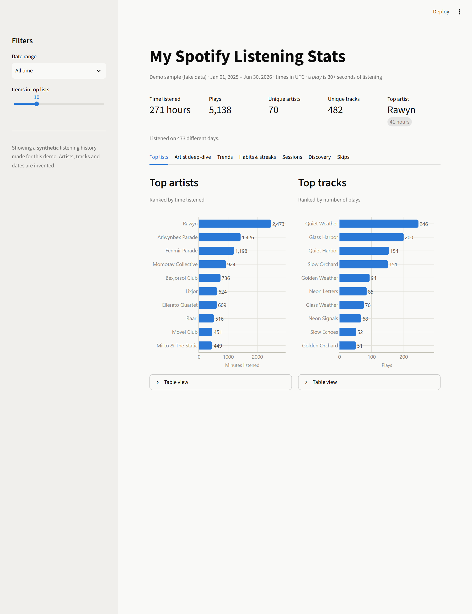
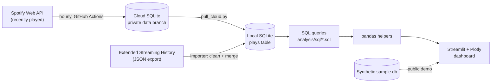
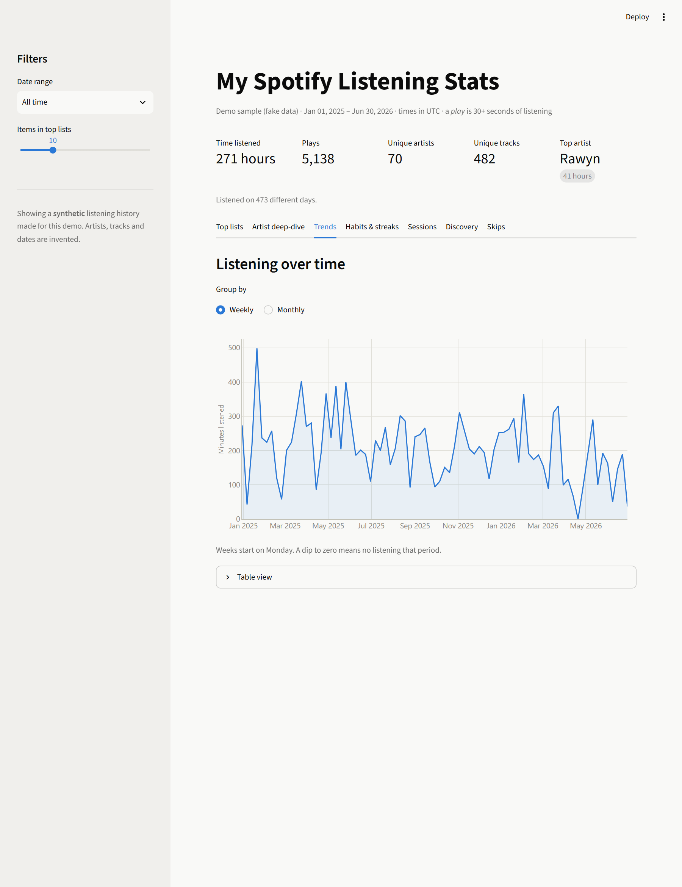
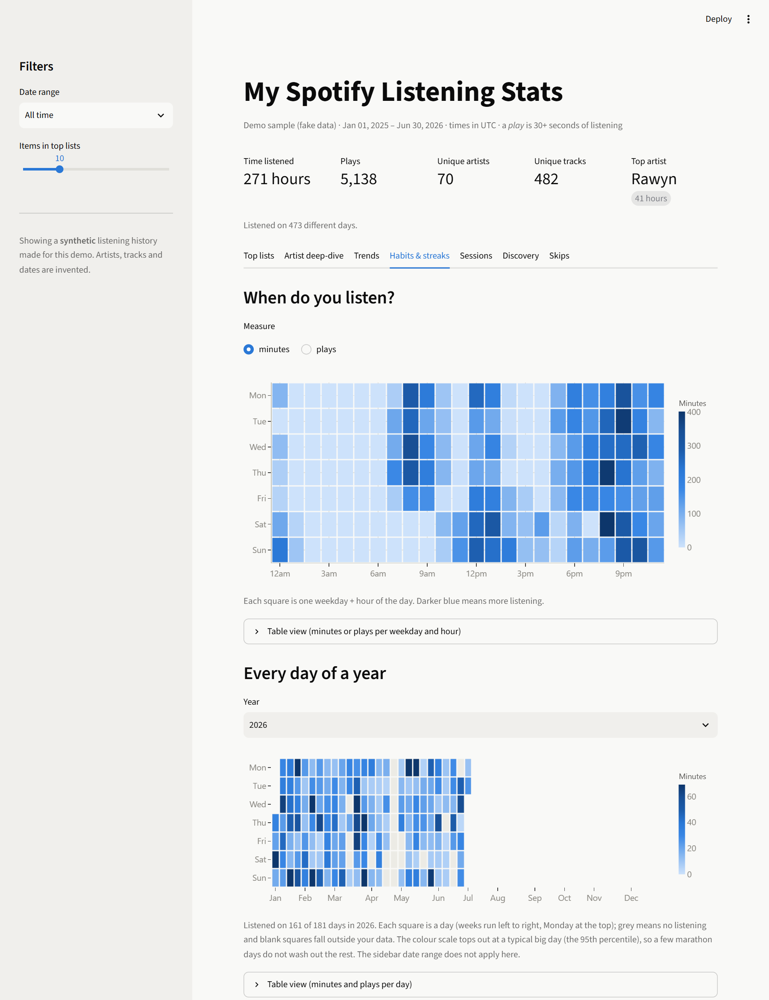
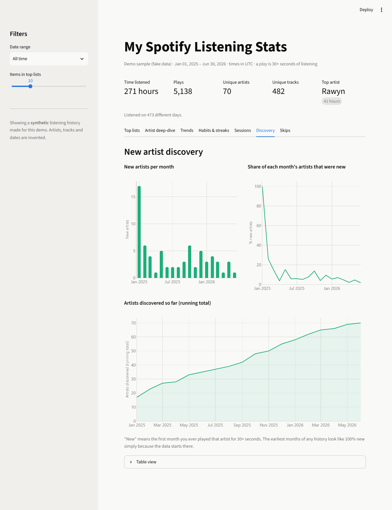
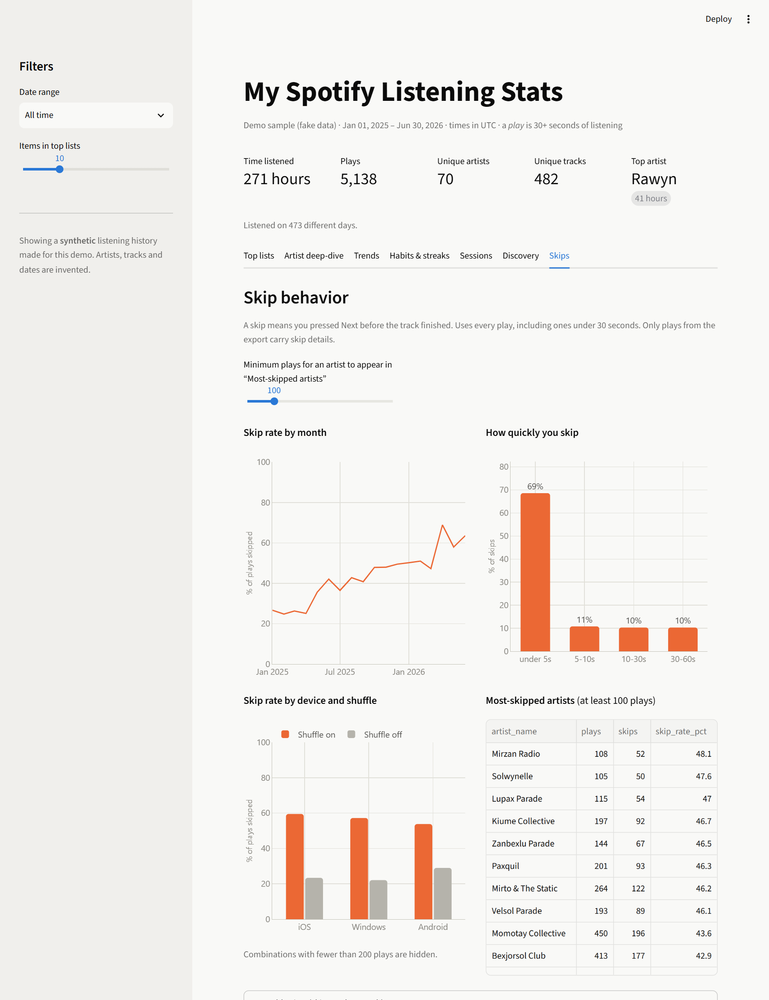
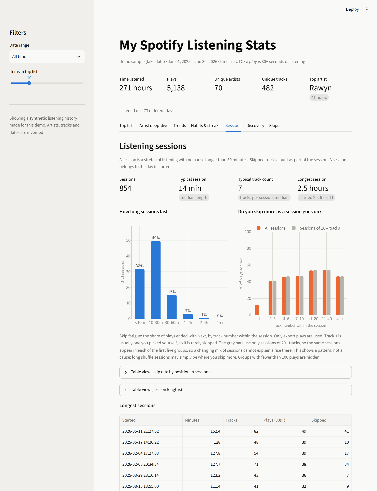
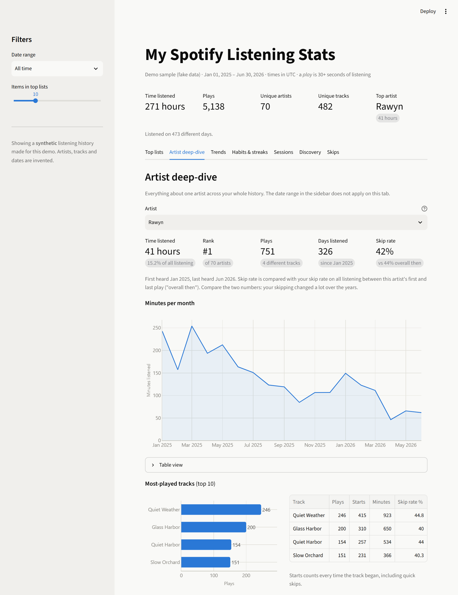

# Spotify Listening Analytics

An end-to-end data project: an automated pipeline that collects my Spotify listening history, a SQL + pandas analysis layer, and an interactive dashboard.

**[▶ Live demo](https://spotify-listening-dashboard-tluhyr8wdbchjxtcritp4t.streamlit.app/)** (runs on a synthetic dataset, see [Privacy](#privacy))



## What it does

- **Collects** my recently played tracks every hour with a scheduled GitHub Actions job and stores them in SQLite, with no duplicates.
- **Imports** my Spotify *Extended Streaming History* export (about 288,000 plays over 9 years), cleans it, and merges it into the same database. Plays that overlap with the API data are enriched, not duplicated.
- **Analyzes** the data with 19 hand-written SQL queries (window functions, CTEs, gaps-and-islands streaks and sessions) plus pandas for reshaping.
- **Visualizes** it in a Streamlit dashboard with seven tabs: top lists, an artist deep-dive page, weekly/monthly trends, habits (a weekday-by-hour heatmap, a calendar heatmap of every day in a year, and streaks), listening sessions with a skip-fatigue analysis, new-artist discovery, and skip behavior. Most views can be filtered by date range.

## Architecture



**Why two databases?** GitHub Actions starts every run on a fresh machine, so the hourly collector keeps a small API-only database on a private branch. My full history, including the export, lives in a local database. A pull script merges the cloud plays in, and only ever adds rows.

## Tech stack

| Layer | Tools |
|---|---|
| Collection | Python, [Spotipy](https://spotipy.readthedocs.io/), Spotify Web API (OAuth refresh token) |
| Automation | GitHub Actions (scheduled workflow), GitHub Secrets |
| Storage | SQLite (schema in plain SQL, with a migration for older databases) |
| Analysis | SQL (CTEs, window functions), pandas |
| Dashboard | Streamlit, Plotly |
| Quality | pytest (62 tests), headless Streamlit app tests |

## Data engineering decisions

The interesting work was in the details of the data, not just the charts:

- **De-duplication.** A play is identified by its end time (to the second, UTC) plus the track URI, enforced with a `UNIQUE` constraint and `INSERT OR IGNORE`. I verified on real data that the API and the export agree to the second, so the two sources merge exactly.
- **Enrich, don't duplicate.** The export knows how long I listened and whether I skipped, and the API doesn't. When both describe the same play, a SQL `UPDATE ... FROM` copies the export's fields onto the existing row.
- **What counts as a play.** Only about a third of the rows in the export are 30 seconds or longer. Counts and rankings use Spotify's own 30-second rule, while skip analysis uses every row.
- **What counts as a skip.** The export's `skipped` flag is `false` for every play from 2018 to 2021 and is only populated from 2022. A skip here means pressing Next (`reason_end = 'fwdbtn'`), which is recorded in all years.
- **Sessions.** A session is a run of plays with no gap over 30 minutes. Every play is stamped with when it *ended*, so its start is `ended - ms_played`, and a window function (`LAG`) compares each play's start with the previous play's end. A running total of the "new session" flags numbers the sessions, and the date filter is applied *after* that, so a date range never cuts a session in half.
- **Skip fatigue, with a control.** Skip rate by position within a session rises as sessions go on, but long sessions are the only ones that reach late positions, so the mix of sessions changes along the chart. The dashboard therefore also shows sessions of 20+ tracks on their own, where the same sessions appear in every position group. It is still a pattern, not a proven cause.
- **Time zones.** Spotify stores UTC. Hours and days are converted to my time zone with daylight saving handled. Caching the UTC offset instead of converting every play individually cut a full analysis run from 65 s to 14 s.
- **Development Mode limits.** The app only uses endpoints still available to Development Mode apps (recently played, top items, playlists). It does not use audio features, recommendations or popularity.

## Insights from my listening history

My own data, Nov 2017 to Oct 2026:

1. **Scale.** 3,706 hours of listening (plays of 30+ seconds) across 1,501 artists and 7,953 tracks, on 2,021 different days.
2. **Most plays are previews.** Only 95,721 of 287,697 plays (33%) lasted 30 seconds or more. 53% of all plays ended with the Next button, and **69% of those skips happened within 5 seconds**.
3. **Skipping took off in 2024.** The skip rate was 20% in 2022 and 26% in 2023, then jumped to 61% in 2024, 69% in 2025 and 73% so far in 2026.
4. **Shuffle is the biggest driver.** Since 2024, 73% of plays skipped on iOS with shuffle on, against 43% with shuffle off. On Windows it is 51% against 8%.
5. **A listening rhythm.** 44% of my listening time falls between 11 am and 4 pm. My longest streak was **96 days in a row** (Sep 10 to Dec 14, 2023).

*Caveats:* these are descriptive, not causal, and 2026 is a partial year. The skip trend could reflect a real change in how I listen, a change in how Spotify logs Next presses, or both. Discovery rates look inflated in the first months because the data starts in Nov 2017.

## Screenshots

*Screenshots show the synthetic demo data.*

| | |
|---|---|
|  **Trends:** weekly and monthly minutes |  **Habits & streaks:** weekday × hour heatmap |
|  **Discovery:** new artists over time |  **Skips:** how, when and where I skip |
|  **Sessions:** session length and skip fatigue |  **Artist deep-dive:** one artist's whole history |

## Privacy

- Credentials (`.env`) and personal data are git-ignored: the SQLite database, the raw Spotify export, and the OAuth refresh token never enter version control. The hourly job reads credentials from GitHub Secrets.
- The importer deliberately never copies the export's IP address or country.
- The live demo and every screenshot use `data/sample/sample.db`, a **synthetic** history generated by `scripts/make_sample_data.py` (invented artists and tracks, fixed random seed).
- The collector's real data lives on a private branch of a private repository, and this public repository contains only code and the fake sample.

## Getting started

Windows / PowerShell shown. Requires Python 3.11+.

```powershell
git clone https://github.com/Vic-Analytics/spotify-listening-dashboard.git
cd spotify-listening-dashboard
py -m venv .venv
.\.venv\Scripts\Activate.ps1
pip install -r requirements.txt -r dashboard/requirements.txt
```

**Try the dashboard with the demo data** (no Spotify account needed):

```powershell
python -m scripts.make_sample_data      # builds data/sample/sample.db (already included)
$env:DASHBOARD_DEMO = "1"
streamlit run dashboard/app.py
```

**Use your own Spotify data:**

1. Create an app at the [Spotify developer dashboard](https://developer.spotify.com/dashboard) with the redirect URI `http://127.0.0.1:8888/callback`.
2. Copy `.env.example` to `.env` and fill in `SPOTIFY_CLIENT_ID`, `SPOTIFY_CLIENT_SECRET` and `TIMEZONE`.
3. Log in once and verify:
   ```powershell
   python -m collector.login          # opens your browser and saves a refresh token to .env
   python -m collector.check_login    # logs in without a browser, like the automated job
   python -m collector.run            # fetch the last 50 plays into data/spotify.db
   ```
4. *(Optional)* Request your [Extended Streaming History](https://www.spotify.com/account/privacy/), extract it into `data/raw/`, then:
   ```powershell
   python -m importer.import_export
   ```
5. Explore: `python -m analysis.report` prints every query, and `streamlit run dashboard/app.py` opens the dashboard.

**Automate collection:** push the code to a *private* repository and add `SPOTIFY_CLIENT_ID`, `SPOTIFY_CLIENT_SECRET`, `SPOTIFY_REFRESH_TOKEN` and `SPOTIFY_REDIRECT_URI` as Actions secrets. Edit the repository name in the `if:` guard of `.github/workflows/collect.yml` to match yours. To bring cloud-collected plays into your local database, run `python -m database.pull_cloud` (or use the dashboard's Sync button).

**Run the tests:** `python -m pytest`

## Project structure

```
collector/      Spotify login, fetch recently played, hourly collector
importer/       Extended Streaming History cleaner + merger
database/       SQLite schema (schema.sql), connection helpers, cloud pull
analysis/       sql/*.sql queries, query runner, pandas helpers, report
dashboard/      Streamlit app and Plotly chart builders
scripts/        Synthetic sample-data generator, public-repo publisher
data/sample/    Synthetic demo database (the only data in this repo)
tests/          pytest suite (database, importer, analysis, dashboard)
.github/        Hourly collection workflow
```

## Limitations and next steps

- Spotify's API only returns the last 50 plays, so the hourly collector would miss plays if I listened to more than 50 tracks within one hour. The export fills in any gap.
- Development Mode apps cannot use audio features or recommendations, so there is no mood or genre analysis.
- Ideas: genre analysis through another data source (the export has artist names but no Spotify artist IDs, so matching would be approximate), and forecasting weekly listening time.
- Artists are matched by name. Collaborations are credited to the track's main artist only.
